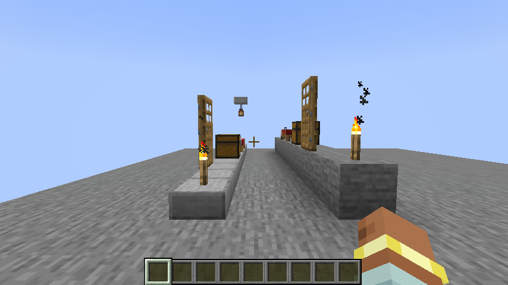
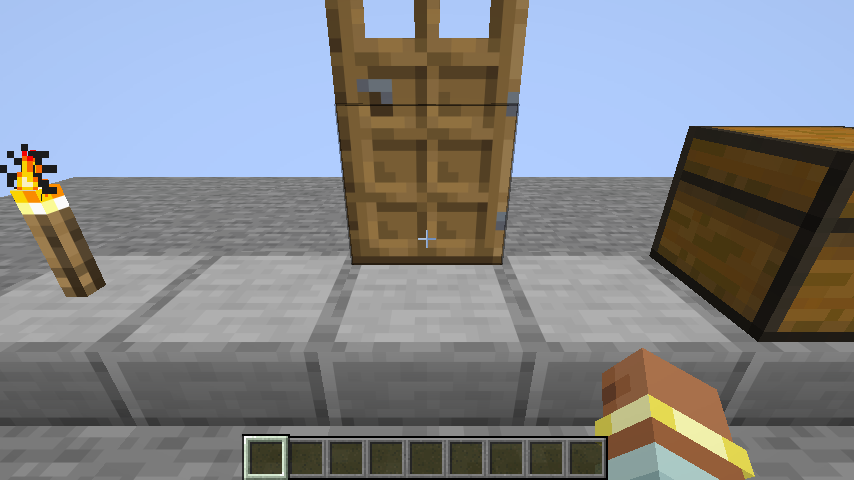
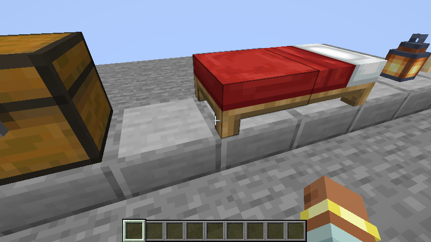

# Chysalis - Propagate

An addon for [Chysalis](https://github.com/TripleStandart/Chysalis) (Minecraft 26.3, Fabric Loader 0.20.1).

Put **doors, beds, torches, lanterns, signs, rails, chests, carpets, buttons, ladders** and other
non-block things on **partly chiseled blocks**. They sit on the real carved surface, as close as the
carving allows, and never cut into it.

Install it next to Chysalis and Fabric API, on the server **and** on every client (both sides move things
the same way; the server sends its config to the clients).



*Screenshot from the automated client test: vanilla bottom slabs stand in for chiseled blocks (left), full blocks for comparison (right).*

| Door and torch on carved blocks | Chest and bed on carved blocks |
|---|---|
|  |  |

## What it does

For every thing on a chiseled block, Propagate measures the chiseled block's real outline, voxel by voxel,
under the thing's *footprint*. A footprint is the shadow the thing casts on the surface: a torch covers the
middle 4x4 voxels, a door a 3-voxel strip along one edge, a bed the whole face.

* **Where it sits:** the thing moves onto the *highest* point under its footprint. It touches the surface
  there and is never pushed into the carving. Chiseling the block again moves it to the new surface.
* **Whether it holds:** things that need support in vanilla (doors, torches, rails, lanterns, buttons ...) are
  allowed if enough of the footprint touches the surface (default: half of it, counting parts up to one
  voxel lower). Where vanilla already allows it, nothing changes.
* **Several parts move together:** both door halves use the lower half's height. A bed or a double chest
  uses the higher of its two surfaces, so neither half cuts in. With one half on a full block, the whole
  thing stays up.
* **Everything follows:** outline, collision, model, block-entity rendering (chests, beds, signs, banners,
  heads), torch and candle particles and sleeping players. The crosshair also finds the parts that reach
  down into the chiseled block's space.
* **Hanging and wall things too:** a lantern or hanging sign under a block carved from below moves up into
  it. A wall torch, ladder or sign on a recessed side moves back into the recess.

Nothing is stored in the world. Positions are worked out from the blocks, so removing the mod just puts
everything back where vanilla places it.

## Categories

Every thing belongs to a **category**, which says how it finds its surface:

| Category | Surface | Needs support | Default members |
|---|---|---|---|
| `standing` | block below | yes | doors, rails, pressure plates, redstone dust, repeaters / comparators, torches, candles, standing signs and banners, sea pickles |
| `resting` | from the state (usually below) | no, only moved | beds, chests, ender chests, flower pots, heads, decorated pots, cakes, lecterns, enchanting tables, brewing stands, campfires, carpets, trapdoors, chains, end / lightning rods, anvils, grindstones ... |
| `hanging` | block above | yes | hanging signs, spore blossoms, hanging roots |
| `mounted` | block behind (from `facing`) | yes | wall torches, ladders, wall signs, wall banners, tripwire hooks, wall heads |
| `attached` | read from the block state | yes | lanterns (standing or hanging), buttons, levers, bells, amethyst, pointed dripstone |

A block goes into a category through **`config/propagate.json`**, using these keys (strongest first):

* `"minecraft:oak_door"`: one block
* `"#minecraft:doors"`: a block tag (the first tag that matches wins)
* `"class:net.minecraft.world.level.block.DoorBlock"`: that class **and every subclass**. Modded doors,
  beds and torches that extend the vanilla classes are therefore picked up automatically. The most
  specific class wins, so `WallTorchBlock` goes to `mounted` even though it extends `TorchBlock`.
* `"mod:somemod"`: every block of a mod

Set a block to `"none"` to leave it alone. Plain full blocks are never moved (`allow_full_blocks`), and
Chysalis' own blocks are surfaces, not things.

You can change or add categories: `anchor` (`down`, `up`, `side`, `auto`), `needs_support`, `min_coverage`,
`tolerance` (in voxels), `union_properties` (states that share one footprint, so a door does not jump when it
opens), `move` (`false` = only relax the support rules) and `footprint` (`shape`, `center`, `full`).
The file explains every key at the top.

**Without editing the file:** data packs can add blocks to the tags `#propagate:standing`, `#propagate:resting`,
`#propagate:hanging`, `#propagate:mounted`, `#propagate:attached` and `#propagate:never`, and add more
surfaces to `#propagate:supports`. By default the surfaces are `chysalis:chiseled` and `chysalis:shaped`.
Any block shape works, so slabs or stairs can be added too.

## Commands

* `/propagate inspect`: what Propagate does with the thing you look at (or the thing on the chiseled block you look at):
  which config entry decided, its category, how much of it touches, whether it holds and how far it moved.
* `/propagate categories`: the categories and their settings.
* `/propagate set <block> <category|none|default>`: put a block into a category (gamemaster). This is saved to the file and sent to everyone.
* `/propagate reload`: re-read the file and send it to everyone (gamemaster).

## Building

Needs JDK 25. CI (`.github/workflows/build.yml`) builds the jar, runs the unit tests and the server game tests
(`gradle runGameTest`: real placement on a headless server, with vanilla slabs standing in for chiseled blocks),
and runs a client game test (SDL offscreen + Mesa) that builds a scene and takes the screenshots above. A push to `main` with a new `mod_version` publishes a release.

```
gradle build          # jar in build/libs/, unit tests
gradle runGameTest    # server game tests
```

## How it works

* `geom/`: plain Java, unit-tested. `DepthMap` holds how far the surface lies behind a face, per 1/16 cell.
  `Footprint` is a thing's shadow. `Fit` gives the offset (the smallest depth under the footprint) and the
  coverage.
* `rules/`: config matching, cached on every block state (one field read for untouched blocks). It also
  reads property names (`hanging`, `face`, `attachment`, `half`, `facing`, `DoubleBlockHalf`, `BedPart`,
  `ChestType`), so modded blocks that reuse vanilla properties work.
* `mixin/BlockStateBaseMixin`: moves the outline, collision, visual and interaction shapes. It answers
  `isFaceSturdy` for chiseled blocks only while a categorized thing is asking (during `canSurvive` /
  `updateShape`), so fences, redstone and mob spawning keep their vanilla behaviour.
* Client: a model wrapper (Fabric Renderer API) shifts terrain quads, a mixin on the block-entity dispatcher
  shifts block-entity renderers, and particles from `animateTick` are shifted too.

Ideas from [Slabbed](https://github.com/peetsamods/slabbed) and
[Lower My Paths and Slabs](https://github.com/dooji2/lower-my-paths-and-slabs), which do the same for slabs.
Propagate generalises their fixed half-block offset to any carved shape, measured under each thing's own footprint.

## Known gaps

* The block-breaking crack overlay is drawn at the thing's vanilla position.
* Item frames and paintings (entities) are not moved.
* Bells fixed between walls are left alone (they have no single surface).
* Turning on `allow_full_blocks` needs a resource reload (F3+T) before full blocks' models move.

## License

MIT
